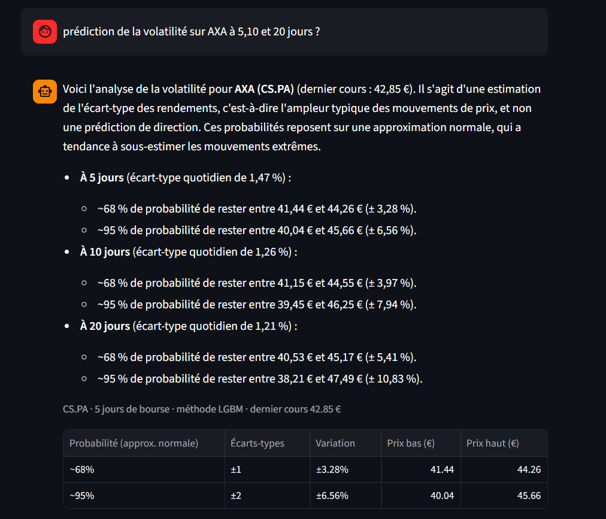
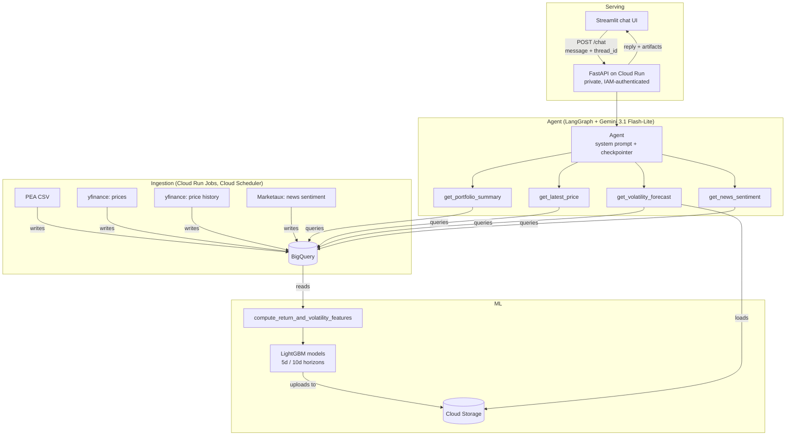

# Portfolio MLE Finance


A conversational copilot for a personal PEA (French stock savings plan)
portfolio: ask about your holdings, get short-term volatility forecasts
as price ranges, and read recent news with sentiment scores — grounded
in real data via a BigQuery-backed agent built with LangGraph and Gemini.

Built as an end-to-end MLE portfolio project: scheduled ingestion, data
validation, feature engineering, model comparison against baselines, an
agentic layer with tools and conversation memory, an HTTP API, a chat
interface, and infrastructure as code — all on GCP, under a strict
€15/month budget with an automatic billing circuit breaker.

## What it does

Ask the copilot things like:
- *"What are my current positions?"*
- *"What's the latest news on Sanofi? Is it rather positive?"*
- *"What's the volatility of LVMH over a month?"* … then *"and over a week?"*

The agent decides which tool(s) to call, queries BigQuery and a trained
LightGBM model, and answers in French. It remembers the conversation:
follow-up questions reuse the company and horizon already discussed.



## Design principle: the LLM words, the tools count

Every figure shown to the user comes from a tool, never from the LLM's
text generation (see [ADR-017](docs/decisions/017-conversation-memory-and-structured-rendering.md)).
Each tool returns two things:

- a **short text summary** for the LLM, with figures already interpreted
  (e.g. *"~68% chance the price stays within ±6.43% (355.09–403.91 EUR)"*);
- a **structured artifact** the LLM never sees, rendered directly by the
  interface as a table.

The LLM comments; the interface displays exact data. A volatility
forecast, for example, is shown as ±1 and ±2 standard deviation price
ranges over the requested horizon, with their approximate probabilities
under a normal approximation — stated as such, since real returns have
fatter tails.

## Architecture



## Tech stack

- **Ingestion**: Python, `yfinance`, Marketaux API, BigQuery; scheduled
  with Cloud Run Jobs and Cloud Scheduler
- **ML**: pandas, scikit-learn, LightGBM, chronological train/test split
  with purge gap; models stored in Cloud Storage
- **Agent**: LangGraph, Gemini API (`gemini-3.1-flash-lite`), in-process
  conversation memory (checkpointer)
- **API**: FastAPI, Docker, Cloud Run (private service)
- **Interface**: Streamlit
- **Infrastructure**: OpenTofu (remote state on Cloud Storage), Secret
  Manager, budget alerts + billing circuit breaker (Pub/Sub, Cloud Function)
- **Quality**: `uv`, `ruff`, `pre-commit`, `pytest`, GitHub Actions CI

## Quickstart

### 1. Environment variables (`.env`)

```
GOOGLE_API_KEY=your_gemini_api_key
MARKETAUX_API_KEY=your_marketaux_key
```

### 2. Install dependencies

```bash
uv sync
```

### 3. GCP setup

Requires a GCP project and `gcloud auth application-default login` run
locally. The whole infrastructure (BigQuery dataset and tables, buckets,
Artifact Registry, Cloud Run service and jobs, schedulers, secrets, IAM,
budget) is described in [`infra/`](infra/) with OpenTofu:

```bash
cd infra
tofu init
tofu plan
```

### 4. Run the ingestion pipeline (in order)

In production, these run on a schedule (Cloud Run Jobs). Locally:

```bash
uv run python -m ingestion.batch.load_pea_csv
uv run python -m ingestion.batch.load_price_history
uv run python -m ingestion.streaming.fetch_market_prices
uv run python -m ingestion.streaming.fetch_news_sentiment
```

### 5. Train the volatility models

Trains the final models and uploads them to Cloud Storage:

```bash
uv run python -m ml.training.train_final_models
```

### 6. Run the copilot

CLI:
```bash
uv run python -m agents.orchestrator.portfolio_agent
```

API (then open http://localhost:8000/docs):
```bash
uv run uvicorn api.main:app --reload
```

Chat interface (with the API running), in a second terminal:
```bash
uv run --group ui streamlit run ui/app.py
```

Docker:
```bash
docker build -t portfolio-mle-finance-api .
docker run -p 8080:8080 --env-file .env portfolio-mle-finance-api
```

## Key results

Volatility forecast, LightGBM vs. baselines (MAE, lower is better) —
see [ADR-010](docs/decisions/010-volatility-horizon-choice.md):

| Horizon | Best model           | MAE      | vs. persistence baseline |
|---------|-----------------------|----------|---------------------------|
| 5 days  | LightGBM              | 0.005482 | -25%                      |
| 10 days | LightGBM              | 0.004093 | -24%                      |
| 20 days | Persistence baseline  | 0.003416 | LightGBM is +0.6% worse   |

LightGBM is only used where it measurably beats a naive baseline; the
20-day forecast intentionally uses persistence instead of a trained
model.

## Agent evaluation

Unit tests replace the LLM with fakes; a separate evaluation measures the agent
itself on 17 reference questions: does it call the right tool, with the right
arguments? Cases are tagged by capability (ticker resolution, horizon
normalization, parallel calls, irrelevance…) and built from real failures — see
[ADR-020](docs/decisions/020-agent-evaluation-tool-calls.md).

```bash
make eval
```

The first run scored 11/17: error analysis traced 5 of the 6 failures to a
single system prompt rule. Fixing it reached 16/17 and revealed a regression on
an ETF ticker, fixed in turn: 17/17.

## Project structure

```
agents/         Agent orchestrator (system prompt, memory) + tools
api/            FastAPI service (/chat, /health)
core/           Shared configuration, lazily-created clients, model loading
docs/decisions/ Architecture Decision Records (ADRs)
infra/          Infrastructure as code (OpenTofu)
ingestion/      Batch and streaming ingestion scripts + scheduled entry points
ml/             Feature engineering, training, evaluation
tests/          Unit tests
ui/             Streamlit chat interface (thin client of the API)
```

## Decision log (ADRs)

Every non-trivial technical decision is documented, including the
compromises and the alternatives that were rejected — see
[`docs/decisions/`](docs/decisions/) for the full list. Some notable
ones:
- [ADR-010](docs/decisions/010-volatility-horizon-choice.md) — why
  the volatility model differs by horizon
- [ADR-015](docs/decisions/015-marketaux-news-sentiment-source.md) —
  how the news/sentiment source was chosen, after two failed attempts
- [ADR-016](docs/decisions/016-purge-bug-fix.md) — a data leak found
  and fixed in the project's own evaluation methodology
- [ADR-017](docs/decisions/017-conversation-memory-and-structured-rendering.md) —
  conversation memory, and why figures never go through the LLM
- [ADR-018](docs/decisions/018-news-retrieval-recency-then-relevance.md) —
  a "latest news" bug and how news retrieval was fixed

## Known limitations / Roadmap

- **The agent evaluation covers tool calls only** — not yet the faithfulness of
  the figures in the answer, nor multi-turn behaviour (memory, system prompt
  rules). Each case runs once: a repetition option would measure the LLM's
  variability.
- **Volatility ranges assume a normal distribution** — the ~68% / ~95%
  probabilities are not yet checked against historical data. Planned:
  return distribution analysis (QQ-plot, kurtosis), empirical coverage
  of the ranges, and an alternative without the normality assumption
  (GARCH with Student-t errors, or LightGBM quantile regression).
- **Conversation memory is in-process** — lost when the service restarts
  and not shared across instances; acceptable for a single user. Upgrade
  path: a persistent checkpointer. The history sent to the LLM is not
  trimmed yet, also acceptable at this scale.
- **News questions work per company only** — no semantic search across
  articles yet (e.g. "news about the luxury sector"). Planned: Vertex AI
  Search.
- **No CD (continuous deployment) yet** — CI runs lint + tests; Cloud
  Run deployment is still manual.
- **No dev/staging/prod separation** — single GCP project today.
- **No model registry or experiment tracking** — models are versioned
  only by their file name in Cloud Storage.
- **Single train/test split, not walk-forward validation** — the
  purge leak (ADR-016) is fixed, but a more robust multi-window
  evaluation is not yet in place.
- **No production monitoring** — predictions aren't logged against
  actual outcomes.

This project is being built as a learning-by-doing portfolio for a
DS → MLE transition — the gaps above are tracked deliberately, not
hidden.