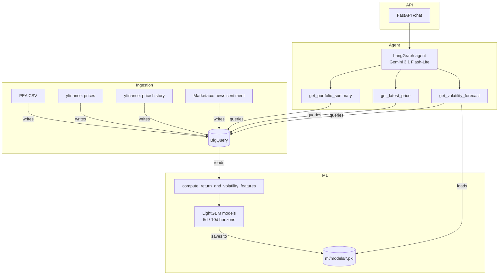

# Portfolio MLE Finance


A conversational copilot for a personal PEA (French stock savings plan)
portfolio: ask questions about your holdings, get short-term volatility
forecasts per position, and (soon) news sentiment — grounded in real
data via a BigQuery-backed agent with LangGraph and Gemini.

Built as an end-to-end MLE portfolio project: batch/streaming ingestion,
data validation, feature engineering, model comparison against
baselines, an agentic layer with tools, and an HTTP API — all on GCP,
under a strict €15/month budget.

## What it does

Ask the agent things like:
- *"What are my current positions?"*
- *"What's the latest price for LVMH?"*
- *"What's the volatility risk on LVMH over the next 5 days?"*

The agent decides which tool(s) to call, queries BigQuery and a
trained LightGBM model, and answers in natural language.

## Architecture



## Tech stack

- **Ingestion**: Python, `yfinance`, Marketaux API, BigQuery
- **ML**: pandas, scikit-learn, LightGBM, chronological train/test split with purge gap
- **Agent**: LangGraph, Gemini API (`gemini-3.1-flash-lite`)
- **API**: FastAPI, Docker, Cloud Run (deployment in progress)
- **Quality**: `uv`, `ruff`, `pre-commit`, `pytest`, GitHub Actions CI

## Quickstart

### 1. Environment variables (`.env`)

```
GOOGLE_API_KEY=your_gemini_api_key
MARKETAUX_API_KEY=your_marketaux_key
ALPHAVANTAGE_API_KEY=your_alphavantage_key
```

### 2. Install dependencies

```bash
uv sync
```

### 3. GCP setup

Requires a GCP project with BigQuery enabled, and `gcloud auth
application-default login` run locally. Dataset `finance_data` with
tables: `portfolio`, `transactions`, `sector_allocation`,
`market_prices`, `price_history`, `news_sentiment`.

### 4. Run the ingestion pipeline (in order)

```bash
uv run python -m ingestion.batch.load_pea_csv
uv run python -m ingestion.batch.load_price_history
uv run python -m ingestion.streaming.fetch_market_prices
uv run python -m ingestion.streaming.fetch_news_sentiment
```

### 5. Train the volatility models

```bash
uv run python -m ml.training.train_final_models
```

### 6. Run the agent

CLI:
```bash
uv run python -m agents.orchestrator.portfolio_agent
```

API:
```bash
uv run uvicorn api.main:app --reload
```

Docker:
```bash
docker build -t portfolio-mle-finance-api .
docker run -p 8080:8080 --env-file .env portfolio-mle-finance-api
```

## Key results

Volatility forecast, LightGBM vs. baselines (MAE, lower is better) —
see [ADR-010](docs/decisions/010-volatility-horizon-choice.md):

| Horizon | Best model           | MAE      | vs. persistence baseline |
|---------|-----------------------|----------|---------------------------|
| 5 days  | LightGBM              | 0.005482 | -25%                      |
| 10 days | LightGBM              | 0.004093 | -24%                      |
| 20 days | Persistence baseline  | 0.003416 | LightGBM is +0.6% worse   |

LightGBM is only used where it measurably beats a naive baseline; the
20-day forecast intentionally uses persistence instead of a trained
model.

## Project structure

```
agents/         Agent orchestrator + tools (BigQuery-backed)
ingestion/      Batch and streaming ingestion scripts
ml/             Feature engineering, training, evaluation
api/            FastAPI wrapper
docs/decisions/ Architecture Decision Records (ADRs)
tests/          Unit tests
config.py       Centralized project configuration
clients.py      Lazily-created shared clients (BigQuery, Gemini)
```

## Decision log (ADRs)

Every non-trivial technical decision is documented, including the
compromises and the alternatives that were rejected — see
[`docs/decisions/`](docs/decisions/) for the full list. Some notable
ones:
- [ADR-006](docs/decisions/006-gdelt-deprioritized.md) — why GDELT
  was abandoned as a news source
- [ADR-010](docs/decisions/010-volatility-horizon-choice.md) — why
  the volatility model differs by horizon
- [ADR-015](docs/decisions/015-marketaux-news-sentiment-source.md) —
  how the news/sentiment source was chosen, after two failed attempts
- [ADR-016](docs/decisions/016-purge-bug-fix.md) — a data leak found
  and fixed in the project's own evaluation methodology

## Known limitations / Roadmap

- **Docker image doesn't yet include trained models** — a volatility
  question fails on the deployed container today. Fix in progress
  (loading from Cloud Storage at startup).
- **No CD (continuous deployment) yet** — CI runs lint + tests; Cloud
  Run deployment is still manual.
- **No dev/staging/prod separation** — single GCP project today.
- **No model registry or experiment tracking** — trained models are
  local `.pkl` files, not versioned with metadata.
- **Single train/test split, not walk-forward validation** — the
  purge leak (ADR-016) is fixed, but a more robust multi-window
  evaluation is not yet in place.
- **No production monitoring** — predictions aren't logged against
  actual outcomes.
- **News sentiment data is ingested but not yet consumed** by any
  tool or model.
- **No agent evaluation set** — no automated check that the agent
  calls the right tool with the right arguments.

This project is being built as a learning-by-doing portfolio for a
DS → MLE transition — the gaps above are tracked deliberately, not
hidden.
