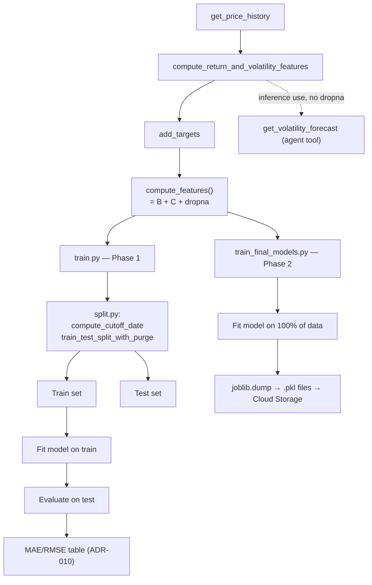

# ML pipeline — volatility forecasting

## Two distinct phases, two different goals

### Phase 1 — Methodology validation (`training/train.py`)

Goal: honestly measure whether a trained model beats naive baselines,
at each prediction horizon.

- Splits historical data chronologically: train (past) / test (future,
  never seen by the model), with a purge gap to prevent target leakage:
  the last `purge_days` rows of each ticker before the cutoff are
  dropped from train, so no training target overlaps the test period
  (see ADR-009, and ADR-016 for the calendar-day bug that was fixed).
- Trains on train only, evaluates on test only.
- Output: a comparison table (MAE/RMSE per model per horizon) — this
  is the deliverable of this phase, not a model to deploy.
- Result (see ADR-010): LightGBM beats all baselines at 5 and 10 days;
  at 20 days, the naive persistence baseline (today's volatility) wins.

Run: `uv run python -m ml.training.train`

### Phase 2 — Final model training (`training/train_final_models.py`)

Goal: once Phase 1 has validated *that* and *where* LightGBM helps,
train the actual model that will be used in production — on ALL
available data (no held-out test set needed anymore, since honesty-
testing already happened in Phase 1).

- Only trains LightGBM for the 5-day and 10-day horizons (per ADR-010
  — no model is trained for 20 days; the agent tool uses the
  persistence baseline directly for that horizon instead).
- Saves trained models to `ml/models/*.pkl` via joblib and uploads them
  to Cloud Storage; the deployed API loads them from there (they are
  not baked into the Docker image).

Run: `uv run python -m ml.training.train_final_models`

## Feature computation: two functions, for two different contexts

- `build_features.compute_return_and_volatility_features(df)` —
  backward-looking features only (past data). Never drops the most
  recent row. **Use this for inference** (predicting on today's data).
- `build_features.compute_features(df)` — the above, plus forward-
  looking target columns, then drops rows with incomplete targets
  (recent rows, which don't have enough future data yet). **Use this
  for training only.**

Using `compute_features()` for inference would silently return stale
data (the row `dropna()` happened to keep, not today's actual row) —
this was a real bug caught during development, not a hypothetical.

## Files
- `training/build_features.py` — feature/target computation
- `training/split.py` — chronological train/test split with purge gap
- `training/train.py` — Phase 1 (methodology validation)
- `training/train_final_models.py` — Phase 2 (final model artifacts)
- `training/visualize_results.py` — bar chart of Phase 1 results
- `analysis/` — return-distribution and interval-coverage analyses of
  the volatility ranges
- `models/*.pkl` — local copies of the final models (git-ignored; the
  API loads them from Cloud Storage)

## Pipeline diagram

